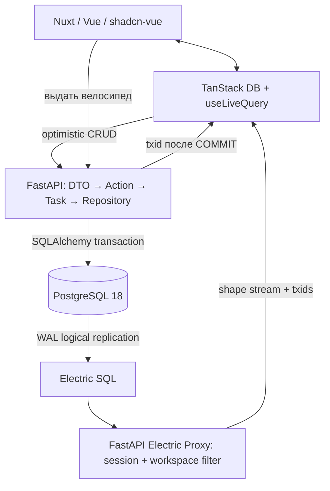

# Spoke — веломастерская

Учебный проект по схеме **UI → TanStack DB → свой API → PostgreSQL → Electric SQL → авторизующий proxy → TanStack DB**. Backend повторяет основной подход `skud-backend`: Python 3.12, FastAPI, SQLAlchemy, Alembic, PORTO, Docker Compose и Caddy. Бизнес-логика и конфигурация СКУД не копировались. Frontend — Nuxt 4, shadcn-vue, TypeScript и Feature-Sliced Design.

## Открыть

- Приложение: **http://127.0.0.1:8097** или http://localhost:8097.
- Схема и объяснение: http://127.0.0.1:8097/architecture.
- Swagger: http://127.0.0.1:8097/api/docs.

Демо-вход автоматический, по умолчанию — руководитель Ирина. При первом запуске создаются 8 активных заказов и один архивный; дальнейшие изменения сохраняются. Попробуйте открыть две вкладки, создать заказ, изменить описание, взять велосипед в работу, завершить ремонт и выдать владельцу. Вторая вкладка обновится без перезагрузки. Есть поиск, фильтры, назначение мастера, срочность, стоимость и удаление заказа из очереди.

## Попробовать связи между сущностями

Откройте **[/team](http://127.0.0.1:8097/team)** под Ириной. Во второй вкладке выберите Марию в переключателе слева и откройте «Мою очередь».

1. У Марии первоначально только бригада «Колёса и сборка». Добавьте её в «Сервис и ТО» в первой вкладке — соответствующие заказы сразу появятся во второй. Строки заказов и их `version` при этом не меняются.
2. Под Марией возьмите свободный заказ. API назначит её и начнёт ремонт одной транзакцией; в первой вкладке обновятся число заказов, срочные и сумма её загрузки.
3. Переименуйте Марию на странице команды. Имя обновится на всех её карточках и в архиве: в заказах хранится только `assignee_id`.
4. Уберите Марию из бригады — её очередь изменится. Старые назначения сохраняются, но права на изменение отзываются; руководитель может переназначить работу.
5. Алексей и Никита состоят в «Сервис и ТО». Если одновременно взять один свободный заказ из двух вкладок, выиграет одна транзакция; второй клиент получит 409 и откатит оптимистичное назначение.

Модель: `users ← team_members → teams ← orders → users (assignee_id)`. Членство уникально по `(team_id, user_id)`. Составные внешние ключи с `workspace_id` запрещают ссылки между мастерскими.

Четыре независимые Electric-коллекции соединяются в `frontend/src/features/workshop-data/model/useWorkshopData.ts`: `innerJoin` членства формирует «Мою очередь», `leftJoin` пользователя подставляет имя, `groupBy + count + sum` вычисляют загрузку. `OrderDto → Order → OrderView` явно отделяет транспорт, модель заказа и проекцию с именами.

Все участники видят данные **своей мастерской**. «Моя очередь» — рабочий фильтр, не граница секретности. Сервер проверяет права записи: руководитель управляет заказами и командой, мастер берёт свободные заказы своих бригад и меняет собственные назначения. Метка «Бригадир» сейчас информационная; управление составом доступно руководителю.

Демо-личность хранится отдельно в каждой вкладке: signed bearer token в `sessionStorage` имеет приоритет над cookie. Переключение пользователя пересоздаёт коллекции. Для отдельной тестовой мастерской: `/?workspace=lab`; вернуться — `/?workspace=studio`.

## Запуск

Нужны Docker с Compose, Make и Python 3 для генерации локального `.env`.

```sh
make up       # создаёт .env, собирает и поднимает контейнеры
make ps
make logs
make down     # останавливает только этот проект, данные сохраняются
```

`make dev` включает bind mounts, Nuxt HMR и Uvicorn reload на том же адресе. После `make dev` команда `make up` возвращает обычную собранную версию. Для полного удаления **данных именно этого демо**: `docker compose down -v`.

Проект имеет имя `spoke-demo`, отдельную сеть и volumes. Единственный опубликованный порт — **127.0.0.1:8097** у собственного Caddy. Порты 80/443 на хосте, существующий Caddy, `/etc/hosts`, сети и базы СКУД не меняются. PostgreSQL и Electric доступны только внутри Compose. Caddy работает по HTTP, с `auto_https off` и `admin off`.

Если порт занят, измените **оба** значения `APP_PORT` и `APP_ORIGIN` в `.env` и выполните `make up`. `APP_ORIGIN` нужен для проверки Origin при записи. Секреты генерируются в `scripts/init_env.py`; чужие `.env` и доступы проекту не нужны.

## Поток данных



1. `POST /api/session` выдаёт подписанный bearer token и резервную HttpOnly cookie. В этом демо нет пароля: доступны пользователи заранее заданных `studio` и `lab`. UI по умолчанию открывает `studio`. Это **учебная авторизация**, не готовая система аккаунтов.
2. Чтение заказов, пользователей, бригад и членства идёт **только через Electric** и `useLiveQuery`, без периодического REST `GET /orders` и без подмены синхронизации WebSocket-рассылкой.
3. `collection.insert/update/delete` немедленно меняет локальное состояние. Persistence handler отправляет команду в API и ждёт `collection.utils.awaitTxId(txid)`.
4. Action открывает транзакцию, task валидирует бизнес-правила, repository выполняет SQL. В той же транзакции получается PostgreSQL xid; ответ уходит **после commit**. Используется младшая 32-битная часть `pg_current_xact_id()` — формат xid в Electric.
5. Electric читает WAL и присылает изменение с xid. Только после него TanStack DB завершает ожидание. Ошибка API откатывает оптимистичное состояние.
6. Выдача велосипеда — пример custom operation в обход CRUD: `POST /api/orders/{id}/deliver`. API блокирует строку, проверяет `ready`, переводит в `delivered`. UI ждёт изменения из Electric и показывает заказ в архиве.

Установлена и зафиксирована в lockfile версия TanStack DB **1.0.0-rc.1.5**: ожидание транзакции — `.when('settled')`. Старые примеры с `.isPersisted.promise` для этой версии не подходят. Electric закреплён на **1.4.2**. Nuxt — **4.7.0**. Это demo для знакомства с текущим стеком, а не обещание стабильности RC API.

## Backend

```text
backend/
  src/
    ship/                       # конфигурация, БД, базовая модель, session auth
    containers/
      order/
        routes/                 # HTTP endpoint → Action
        actions/                # транзакция, оркестрация, сбор Resource
        tasks/                  # конкретные правила и операции
        repositories/           # только доступ к данным; вызываются из tasks
        models/                 # SQLAlchemy ORM
        requests/               # входные Pydantic DTO
        resources/              # явный ORM → публичный DTO
        enums/
      team/                     # users, teams, team_members; управление составом
      session/                  # локальная демо-сессия
      sync/                     # авторизующий прокси Electric
    seed.py                     # одноразовый, идемпотентный seed
  migrations/versions/          # отдельная миграция на каждую таблицу
  tests/                        # интеграционные тесты API + настоящего Electric
```

В actions нет SQL; задачи доменных операций обращаются к repositories. Общий `TransactionIdTask` и repository находятся в `ship`. `OrderResource.from_model()` явно задаёт публичный контракт. Входные DTO запрещают неизвестные поля, пустые обязательные значения, отрицательную стоимость и явный `null` в PATCH, кроме `assignee_id`: `null` снимает назначение.

Правила: очередь → ремонт → готовность → выдача. До выдачи разрешён возврат на предыдущую стадию через PATCH API; интерфейс показывает действия движения вперёд. Удалять можно только очередь. Выданный заказ неизменяем. `version` + `SELECT FOR UPDATE` дают **409**, если два клиента записывают одну версию. Обновление, удаление и выдача всегда ограничены мастерской и правами пользователя. `POST /orders/{id}/claim` проверяет членство, свободное назначение и версию под блокировкой строки. Изменение состава и проверка назначения сериализуются блокировкой бригады; ID членства защищает от запоздалого удаления уже пересозданной связи.

В proxy сервер задаёт `table`, `columns`, `where`, `params[1]` и секрет Electric. Из клиентского запроса пропускаются только параметры протокола. `columns` берётся из публичного Resource, `workspace_id` не выдаётся. Ответы имеют `Cache-Control: private, no-store`. HTTP long polling проксируется с таймаутом 65 секунд; eager sync подходит небольшой учебной доске. Большие датасеты потребуют другого режима синхронизации и ограничений ресурсов.

Обычные миграции меняют схему, seeder создаёт исходные заказы. Миграция `006` также переносит существующие строковые назначения в пользователей, создаёт стартовые бригады и заполняет связи, сохраняя статусы, суммы и версии. Неизвестные старые имена мастеров также сохраняются как пользователи. Маркер `demo_seeds` не позволяет восстанавливать удалённые пользователем карточки при рестарте. `make seed` безопасен для существующей доски.

## Frontend · FSD

```text
frontend/
  app/                          # Nuxt app + тонкие route adapters
  src/
    pages/                      # workshop, team, archive, architecture
    widgets/                    # shell, статистика, доска
    features/manage-order/      # форма и сценарии создания/редактирования/выдачи
    features/workshop-data/     # live joins и агрегаты нескольких сущностей
    features/manage-team/       # членство и переименование
    features/switch-user/       # отдельная личность вкладки
    entities/workforce/         # users / teams / memberships, DTO и коллекции
    entities/session/           # текущая демо-сессия
    entities/order/
      api/                      # Zod DTO, HTTP API, явный маппер
      model/                    # UI-модель и коллекция
      ui/                       # карточка заказа
      index.ts                  # публичный API слайса
    shared/                     # shadcn-vue UI, HTTP client, tokens/styles
```

Зависимости направлены вниз: `app → pages → widgets → features → entities → shared`. Между слайсами — импорты через `index.ts`. Nuxt auto-import не используется для связи бизнес-слоёв. `app/pages` лишь подключает FSD page.

Коллекция содержит транспортную модель `OrderDto` в snake_case. `orderMapper.toModel()` преобразует её в `Order` с camelCase и `Date`. `toCreate/toUpdate` явно ограничивают поля записи. Форма хранит собственный черновик; открытый устаревший черновик не перезапишет изменение из другой вкладки. Статистика вычисляется из той же реактивной коллекции.

Используется `ssr: false`: приложение является интерактивным внутренним инструментом, коллекции и демо-сессия создаются в браузере. SSR для публичного контента в этом примере не нужен. shadcn-компоненты сгенерированы CLI в `shared/ui` (Reka UI + Tailwind 4), а не имитированы. `@source` в CSS явно включает FSD-директории.

## Проверки

Для локальных проверок нужны Node.js 22+, npm, uv и запущенный `make up`:

```sh
cd frontend && npm ci && cd ..
make check
make test
```

- API: валидация DTO, 401/403, изоляция мастерских, защищённые shape-параметры, гонка версий, статусы, custom operation, настоящий xid в Electric.
- Unit: преобразование транспортных данных и whitelist полей PATCH.
- Playwright: реактивный join членства, независимые личности вкладок, смена имени без изменения заказов, живая загрузка, отзыв прав, optimistic claim rollback; две вкладки, CRUD, архив и сохранность после reload, оптимистичное перемещение **до** ответа API и rollback после 409, защита устаревшего черновика, восстановление после отключения сети, поиск, desktop/mobile и стили shadcn.

Playwright использует `/usr/bin/chromium`, если он установлен; иначе выполните `cd frontend && npx playwright install chromium`. Можно указать `CHROMIUM_PATH`. `TEST_BASE_URL` меняет адрес интеграционных тестов.

Тесты записывают UUID созданных заказов и в конце удаляют **только эти UUID** с тестовым именем клиента через `scripts/cleanup_test_orders.py` внутри данного Compose. Полная очистка БД не выполняется. Сценарии отношений используют `lab` и восстанавливают членство/имена после проверки. Скриншоты — `.artifacts/desktop.png`, `.artifacts/mobile.png`, `.artifacts/team-desktop.png`, `.artifacts/team-mobile.png`.

## Что здесь сознательно упрощено

Нет регистрации, паролей, платежей, фоновых задач, офлайн-очереди записей и локального долговременного хранилища. PostgreSQL пользователь в локальном Compose имеет права, необходимые Electric для логической репликации. Для публичного окружения нужны полноценная авторизация, TLS, раздельные роли БД, эксплуатационные лимиты и резервное копирование. Сам Docker запуск привязан к loopback.

Оригинальная схема реализована через [Electric collection](https://tanstack.com/db/latest/docs/collections/electric-collection), [Vue adapter](https://tanstack.com/db/latest/docs/framework/vue/overview) и [proxy auth](https://electric.ax/docs/sync/guides/auth). UI-компоненты: [shadcn-vue для Nuxt](https://www.shadcn-vue.com/docs/installation/nuxt).

## Симулятор входящих заказов

Рядом с проектом лежит **`simulate.py`**. По умолчанию он 10 минут создаёт **10 заказов/мин** (каждые 6 секунд), а один оператор проверяет **5 заказов/мин** (каждые 12 секунд): переводит самый старый заказ из `queued` в `repair` и назначает Алексея. Очередь растёт примерно на 5 заказов/мин. Ремонт дальше автоматически не завершается.

```sh
make simulate                 # в терминале, Ctrl+C для остановки
make simulate-bg              # в фоне, те же 10 минут
make simulate-logs            # смотреть поступления и работу оператора
make simulate-stop            # остановить фоновый процесс раньше

# Свои темпы / длительность; --duration 0 означает до ручной остановки
make simulate SIM_ARGS="--incoming 20 --operator 8 --duration 3"

# Скрипт также запускается самостоятельно через uv (PEP 723)
uv run simulate.py --incoming 10 --operator 5 --duration 10
```

Сначала поднимите проект (`make up`), затем откройте доску. Генератор пишет через API; оператор получает очередь через **настоящий Electric shape stream** и вызывает `POST /orders/{id}/claim` с `version` под отдельной сессией Алексея. Создание выполняется под Ириной; токены не подменяют друг друга. Новые заказы направляются в «Сервис и ТО». Прямого доступа к БД у скрипта нет. Он учитывает chunked snapshot, reconnect/must-refetch и конфликты 409. Оператор обрабатывает только UUID, созданные **текущим запуском**; исходные карточки и ваши заказы не трогает. Демо-заказы видны по имени клиента «Демо · …» и комментарию с ID запуска.

Параметры `--url` и `--workspace studio|lab` позволяют выбрать адрес и демо-мастерскую. Нулевые/отрицательные темпы запрещены. Защита от повторного запуска не позволяет случайно удвоить нагрузку. `--stop` проверяет PID и время запуска процесса. Журналы с UUID и txid сохраняются в `.artifacts/simulator/*.jsonl`; остановка сохраняет созданные заказы на доске. Симулятор не запускается автоматически при `make up`.
